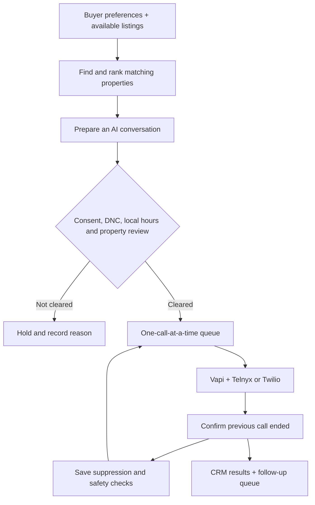

# Outbound AI Voice Automation

**Match the right property to the right buyer, then manage a personalized AI call.**

`n8n` · `Airtable` · `JavaScript` · `Vapi` · `Telnyx / Twilio` · `PostgreSQL`

This project documents the matching workflow, a guarded outbound-call queue, voice-agent prompt, CRM follow-ups, and the checks required before dialing. The sanitized n8n example connects to a **disabled** private queue handoff, not live telephony. All names, field mappings, account settings, and sample records are fictional or masked.

## How it works

The queue moves on only after the previous call has ended and any safety-critical hold is cleared. Ordinary CRM follow-ups are saved to a durable retry queue. An uncertain call state **stops dialing** until reviewed.

## What is included?

| Part | Where to find it |
|---|---|
| Sanitized n8n matching workflow | [`workflow/`](workflow/) |
| Matching, call preparation, phone formatting | [`scripts/`](scripts/) |
| Vapi call client and guarded queue coordinator | [`src/`](src/) |
| Database tables for calls, history and suppression | [`sql/schema.sql`](sql/schema.sql) |
| Sectioned AI voice-agent prompt | [`prompts/outbound-assistant.md`](prompts/outbound-assistant.md) |
| Setup, regulations, testing and recovery | [`docs/`](docs/) |
| Fictional inputs and mock tests | [`examples/`](examples/), [`tests/`](tests/) |

## Read these first

- [Vapi connection and assistant settings](docs/vapi-connections.md) · [Voice prompt by section](prompts/outbound-assistant.md)
- [Phone provider requirements](docs/phone-providers.md) · [Calling safeguards](docs/calling-safeguards.md)
- [Recovery when a call is uncertain](docs/recovery.md) · [Airtable CRM receiver](docs/airtable-receiver.md)
- [Privacy and monitoring](docs/privacy-operations.md) · [v5 changes](CHANGES-v5.md)

## Setup guide

1. **Prepare data:** map your own CRM fields to the sanitized n8n example. Verify that listing region, price, and availability data are accurate.
2. **Set up Vapi:** create or select a saved assistant, import an outbound-enabled Telnyx/Twilio phone number, configure event delivery and assistant tools. Read [Vapi connections](docs/vapi-connections.md).
3. **Set up calling controls:** connect a *private* consent/DNC/eligibility service, an authorized CRM action endpoint, and PostgreSQL. Read [eligibility](docs/calling-safeguards.md) and [data contracts](docs/data-and-crm.md).
4. **Run offline tests:** `npm test` runs offline tests; `npm run test:integration` executes exported-workflow and mocked-integration checks and uses PostgreSQL when `TEST_DATABASE_URL` is configured.
5. **Review deployment:** check [queue behavior](docs/sequential-calling.md), [operations](docs/operations.md), and [launch checklist](docs/checklist.md). Live calls require explicit opt-in switches and operational approval.

## Explore the details

- [What changed in this version](CHANGES-v5.md)
- [Verification matrix and external requirements](docs/verification-matrix.md)
- [Architecture in plain English](docs/architecture.md)
- [What connects to what](docs/integration-boundaries.md)
- [Verification and acceptance tests](docs/test-plan.md)
- [Privacy and security](docs/privacy-and-security.md)
- [Vapi connections and settings](docs/vapi-connections.md)
- [Telnyx vs. Twilio: number and billing requirements](docs/phone-providers.md)
- [NEXUS-style assistant prompt, broken into sections](prompts/outbound-assistant.md)
- [How sequential calls, callbacks and retries work](docs/sequential-calling.md)
- [AI calling rules, consent, DNC and recording](docs/calling-safeguards.md)
- [Field mapping, call history and CRM update contract](docs/data-and-crm.md)
- [Failure handling, security and monitoring](docs/operations.md)
- [Testing and acceptance checklist](docs/checklist.md)
- [Costs and billing factors](docs/costs.md)
- [Primary-source documentation](docs/references.md)

## Health checks

`GET /health` checks process liveness; `GET /ready` checks PostgreSQL connectivity. The private monitor also checks outstanding call/CRM alerts. These are not a substitute for end-to-end acceptance tests. See [operations](docs/operations.md).

## Scope

The recommended n8n export contains matching, preparation, and a disabled queue handoff. The `src/` service is a separate **reference implementation** for the outbound side: it includes live API request construction and a guarded queue, but requires your private services, settings, and review. The example workflow does not automatically dial anyone. Internal contact records, credential secrets, real carrier numbers and execution statistics are excluded. Tests use fictional records.

**Note:** Permission to publish company-owned architecture and scripts should be confirmed with the owner. The safeguards here are engineering controls, not legal certification.
