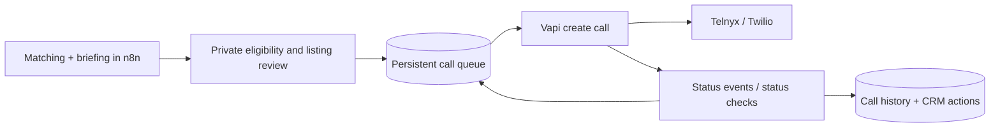

# Architecture in plain English

The system has two parts:

1. **n8n prepares each conversation.** It reads CRM buyer preferences and available property records, matches by region ID, ranks by priority and recency, prepares the property briefing, normalizes phone formats, and removes repeated phone numbers within the run.
2. **A guarded queue handles calls.** It rechecks consent and restrictions using a private eligibility service, permits only one unresolved call, sends a Vapi request, waits for a confirmed end state, and records the outcome before dispatching another.

**Important difference:** a successful `POST /call` is only call creation, not completion. A simple `Wait 30 seconds` does not guarantee sequential calling.

## Repository boundaries

- `workflow/archive/outbound-property-matching.sanitized.json` is a masked representation of the source matching workflow.
- `workflow/outbound-preparation-reference.json` shows how the matching flow can hand off to a private queue. The queue handoff node is connected to the preparation stage but deliberately **disabled**, requiring a private credential and approved listing service.
- `src/service.js` and PostgreSQL implement the queue reference. They are not n8n nodes.
- A private eligibility service is required; no actual national or state DNC lookup is bundled.

## Data safety

Every contact has an idempotency key. Unknown call state blocks the next call. Cross-run suppression lives in PostgreSQL, not in an in-run `Remove Duplicates` node. A manual reconciliation process handles uncertain dispatch results.
