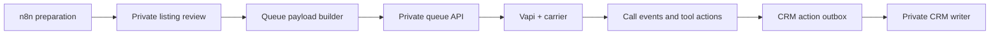

# Integration boundaries

This repository separates three independent components:

1. **n8n preparation** — sanitized Airtable lookups, location matching, ranking, personalized briefings and phone formatting.
2. **Private listing approval** — authoritative listing-review service supplies verified status, city-to-region mapping, price, summary and timestamp. `src/queue-payload.js` binds those approvals to the prepared record; no script can assume approval.
3. **Private queue and CRM** — the queue stores approved jobs in PostgreSQL, calls Vapi only after external consent/DNC checks, polls calls, receives authenticated tool requests and sends idempotent CRM actions.

## Exact handoff

- `buildQueuePayload(prepared, reviewed)` checks that approved property copy and region match n8n's selected listing. It supplies `idempotencyKey` and validated metadata.
- Queue rechecks `LISTING_REVIEW_URL` at dispatch, not only at enqueue. The reviewer must be separately authenticated and validate that the approval applies to the current offer and has not expired.
- `POST /prepare-and-enqueue` accepts the sanitized n8n prepared buyer, retrieves independently approved listing facts and creates a validated queue job. `POST /jobs` accepts a pre-verified payload. Both require `Authorization: Bearer INTERNAL_API_TOKEN` and rejects missing or stale approvals.
- CRM action endpoint must return `{ "applied": true, "actionKey": "..." }` **after durable write**. It must be idempotent by `actionKey` and synchronize DNC to all relevant systems.
- `request_callback` creates a **request**, not a confirmed calendar event.

The published n8n export connects to a **disabled** private queue HTTP node with no credentials. Use a private n8n HTTP Bearer Auth credential after the approval/consent services are ready. It never connects directly to Vapi.
