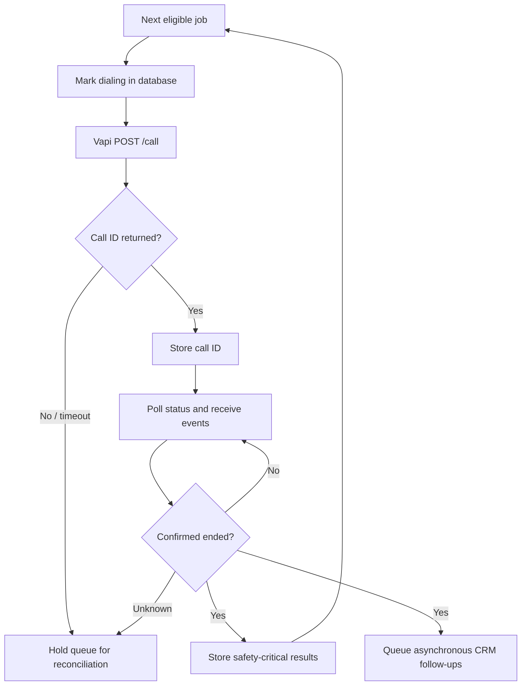

# One buyer at a time

The queue is intentionally **single-flight**: it will not start a second call while the first is active or uncertain.

- **Cross-run concurrency:** PostgreSQL advisory lock serializes worker ticks; DB records preserve active/unknown state after restart.
- **Idempotency:** enqueue with a unique `idempotencyKey`, for example `buyerRef:campaignVersion:listingGroup`. Do not regenerate it when retrying the same intended outreach.
- **Unknown outcomes:** request timeouts may mean the call was created anyway. No automatic redial; reconcile against Vapi/provider logs first.
- **End of call:** get status from Vapi `GET /call/{id}` or authenticated `end-of-call-report` / `status-update` event.
- **No answer / busy:** log the ended reason; only schedule a future attempt if rules and history allow it. There is **no automatic redial** in this sample.
- **Manual recovery:** resolve unknown calls, verify they actually ended, and audit before updating the job to a final state.

Ordinary CRM callback, interest, and outcome actions are durable and synchronized separately; only unresolved safety-critical suppression or missing-call artifacts hold dialing. External legal authorization and live provider verification are still mandatory.

The queue module is [`src/service.js`](../src/service.js). The webhook also accepts validated `tool-calls` events. Read [operations](operations.md) for known failure modes.
